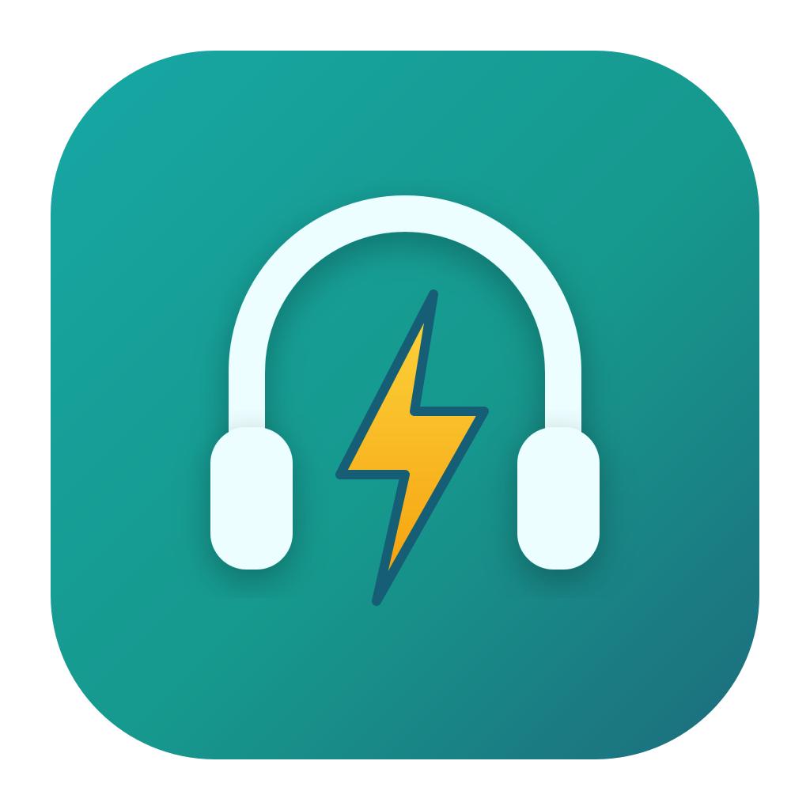
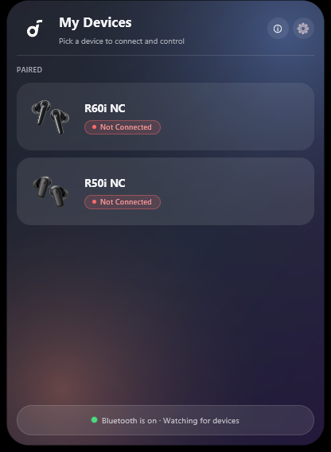
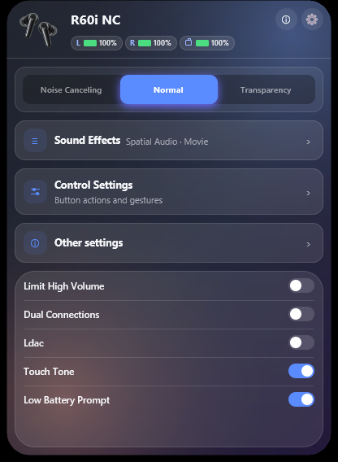
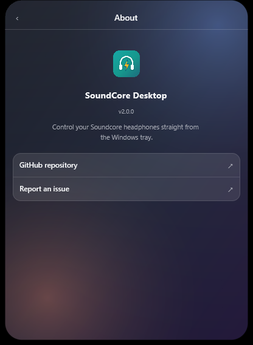
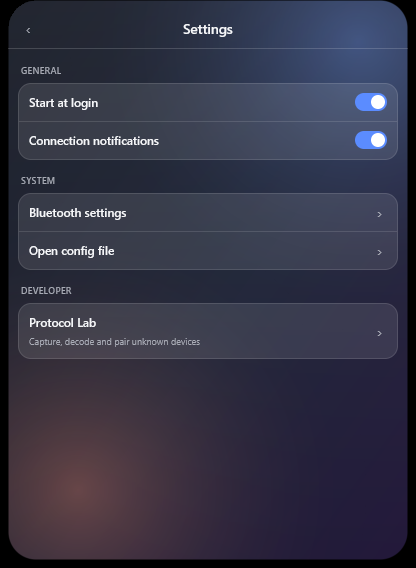

<div align='center'>
<h1>SoundCore-Desktop</h1>


<p>SoundCore-Desktop is a lightweight cross-platform tray app that keeps your Soundcore device settings at hand: it reads your device's current profile the moment it connects (never overwriting it), and puts live controls — gaming mode, ANC, and EQ — in the tray, no phone app needed.</p>


  <a href="https://github.com/pamod-madubashana/SoundCore-Desktop"></a>
  <a href="https://github.com/pamod-madubashana/SoundCore-Desktop"></a>
  <a href="https://github.com/pamod-madubashana/SoundCore-Desktop"></a>
  <a href="https://www.rust-lang.org"></a>
  <a href="https://github.com/Oppzippy/OpenSCQ30"></a>
</p>
</div>
</div>
<br>
<div align="center">

## Downloads

| Platform | Download Link |
|----------|--------------|
| Windows (Setup) | [SoundCore-Desktop-x64-setup.exe](https://github.com/pamod-madubashana/SoundCore-Desktop/releases/latest/download/SoundCore-Desktop-x64-setup.exe) |
| Windows (Portable) | [SoundCore-Desktop.exe](https://github.com/pamod-madubashana/SoundCore-Desktop/releases/latest/download/SoundCore-Desktop.exe) |
| Linux (DEB) | [SoundCore-Desktop-amd64.deb](https://github.com/pamod-madubashana/SoundCore-Desktop/releases/latest/download/SoundCore-Desktop-amd64.deb) |
| Linux (RPM) | [SoundCore-Desktop-x86_64.rpm](https://github.com/pamod-madubashana/SoundCore-Desktop/releases/latest/download/SoundCore-Desktop-x86_64.rpm) |

</div>

## Screenshots

<div align="center">
  
  
  
  
</div>

## Tech Stack

- UI: GPUI (Rust)
- Desktop runtime: Rust tray app
- Device protocol: OpenSCQ30
- Packaging: Cargo

## Why This Project Exists

- Problem: Soundcore device settings are often locked behind the mobile app, so desktop users lose access to gaming mode, ANC, or EQ profiles when the device reconnects.
- Goal: Keep Soundcore device preferences consistent by mirroring the device's own settings into a native desktop tray utility.
- Outcome: A small tray app that shows live device settings at connect, offers quick controls, and removes the need to use the official phone app.

## Project Structure

```
.
├── README.md
├── config.toml
├── assets/
│   ├── devices/
│   │   └── ...
│   └── ...
├── src/
│   ├── main.rs
│   ├── lib.rs
│   ├── shell.rs
│   ├── worker.rs
│   ├── config.rs
│   ├── autostart.rs
│   └── UI/
│       ├── mod.rs
│       ├── theme.rs
│       ├── data.rs
│       └── screens/
│           ├── control.rs
│           ├── devices.rs
│           └── ...
└── OpenSCQ30/          # git submodule (Rust library)
```

## Key Features

- Runs in the system tray with a compact control panel
- Reads your device's current settings the moment it connects (fetch-only — nothing is pushed back)
- Supports quick toggles for gaming mode, ANC, and volume presets
- Build targets for Windows and Linux
- Minimal distraction and no phone app required once configured

## Getting Started

### Prerequisites

- Rust (latest stable)
- Windows 10/11 or Linux
- Git submodules (`--recurse-submodules`)

### Installation

```bash
# Clone the repository
git clone --recurse-submodules https://github.com/pamod-madubashana/SoundCore-Desktop.git

# Navigate to project directory
cd SoundCore-Desktop

# Run in development mode
cargo run
```

### Building

```bash
# Build production bundle
cargo build --release
```

## Usage

1. Launch SoundCore-Desktop; it will appear in your system tray
2. Click the tray icon to open the control panel
3. Add your Soundcore device (auto-detected on most setups)
4. Use the app popup to change settings live — each change is written to the device immediately and saved to the synced profile
5. On the next connect the app re-reads the device's settings, so the popup always reflects reality

## Keyboard Shortcuts

- **Left-click tray icon**: Show/hide control panel
- **Right-click tray icon**: Open context menu (Show/Hide, Quit)


## Credits

- This project uses and credits [OpenSCQ30](https://github.com/Oppzippy/OpenSCQ30) for the underlying Soundcore Bluetooth support and device handling.
